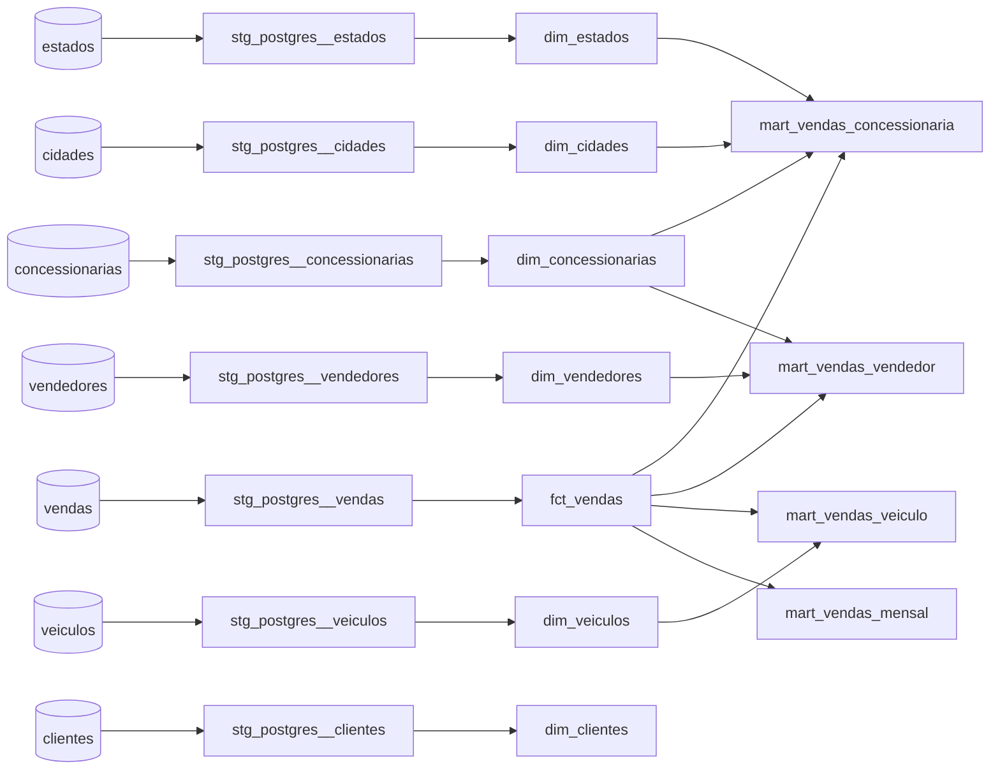

# NovaDrive — Pipeline de dados com Airflow e dbt

Projeto de engenharia de dados para análise de vendas de concessionárias. Os dados são extraídos do PostgreSQL, carregados no Snowflake e transformados com dbt para construir tabelas analíticas.

## Fluxo do projeto

```text
PostgreSQL → Airflow (Docker / AWS EC2) → Snowflake (dados brutos)
                                                 ↓
                              dbt: staging → dimensões e fato → marts
```

O Airflow orquestra a ingestão. O dbt é executado localmente e envia as transformações SQL para o Snowflake.

## Ingestão com Airflow

A carga contempla sete tabelas: veículos, estados, cidades, concessionárias, vendedores, clientes e vendas.

- **Carga incremental:** usa `data_atualizacao`, com `data_inclusao` como alternativa, e uma janela de sobreposição para reler alterações recentes. A primeira execução carrega o histórico anterior ao fim do intervalo.
- **MERGE:** insere registros novos e atualiza os existentes pelo ID, permitindo repetir cargas sem inserir novamente o mesmo registro.
- **Watermark por tabela:** registra o último intervalo concluído. Os dados e o watermark são confirmados na mesma transação; em caso de falha, esse avanço é desfeito.
- **Recuperação de falhas:** leitura em lotes, retries com espera progressiva, timeout e um pool compartilhado com um slot para controlar a concorrência.
- **Reprocessamento manual:** permite selecionar tabelas e reler todos os registros anteriores ao limite final ou uma janela de timestamps, sem alterar o watermark diário.

| Arquivo | Responsabilidade |
| --- | --- |
| `postgres_to_snowflake.py` | DAG de ingestão diária, com uma tarefa por tabela. |
| `novadrive_reprocessamento.py` | DAG manual para reprocessar as tabelas selecionadas. |
| `carga_postgres_snowflake.py` | Função de carga utilizada pelas duas DAGs. |

## Transformações com dbt

- **Sources:** documentam as tabelas brutas disponíveis em `NOVADRIVE.STAGE`.
- **Staging:** views que padronizam nomes, tipos e campos da origem.
- **Marts:** tabelas com dimensões, a fato de vendas e indicadores por concessionária, vendedor, veículo e mês, incluindo quantidade de vendas, faturamento e ticket médio.

Os modelos e suas colunas são documentados em YAML. Os testes verificam unicidade, campos obrigatórios, relacionamentos, valores positivos, coerência de datas e reconciliação entre a fato e os marts.

## Estrutura



## Configuração e execução

Para a ingestão, configure as conexões `postgres` e `snowflake` no Airflow, execute `sql/setup_ingestion_control.sql` no Snowflake e crie o pool `novadrive_ingestion` com **um slot**. Os três scripts devem estar disponíveis na pasta de DAGs dos containers.
